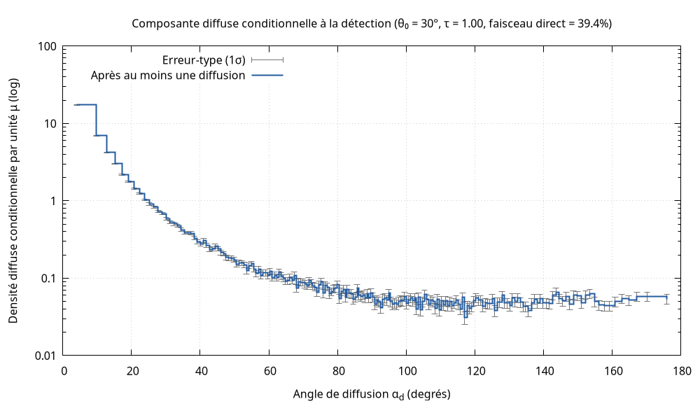
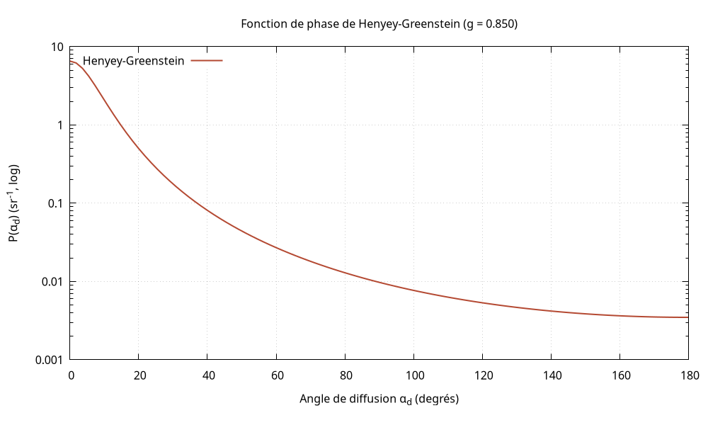
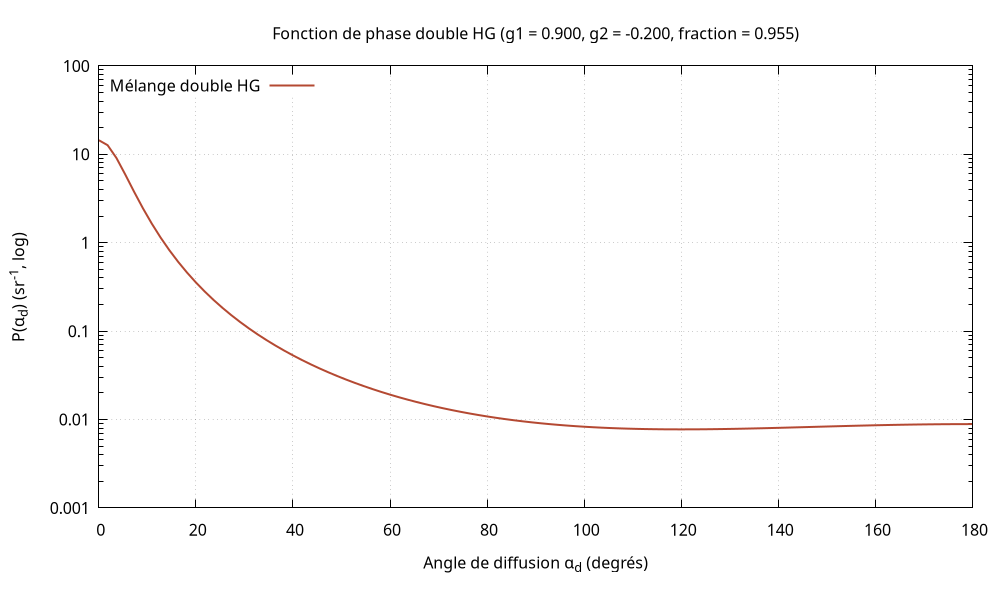
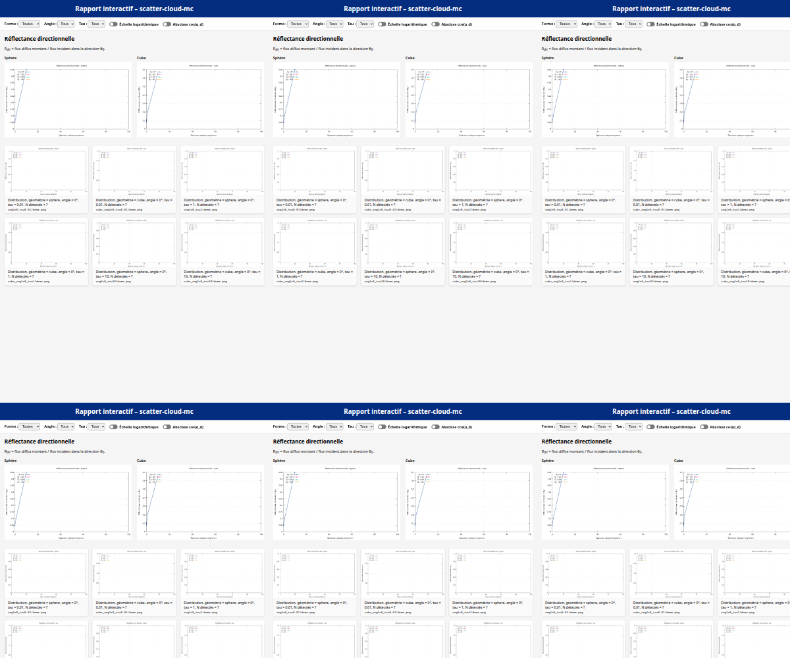

# Scatter Cloud MC

Simulateur Monte Carlo en C11 du transport de photons dans un nuage de forme
configurable : sphère ou cube. Il modélise la diffusion de
Henyey–Greenstein, l’absorption pondérée et l’incidence oblique, puis exporte
des données CSV, des distributions angulaires et des graphiques.

## Prérequis et démarrage rapide

GNU Make, GCC compatible C11 et Bash sont requis pour compiler et lancer les
tests. Gnuplot est requis pour générer les graphiques. Python 3.8 ou plus récent
est nécessaire pour analyser les résidus avec `analyse_diff.py`. Pour
`make quality`, installer aussi clang-format, cppcheck et clang-tidy.

```bash
make build
make test
make run
```

`make run` utilise `config/config.dat` et place les résultats dans
`output/default/` : les CSV bruts, agrégés et de bilan des flux, le PNG et
`stats.txt` (nombre de photons détectés). Le fichier `.flux.csv` contient les
flux diffusés montant et descendant, l'énergie absorbée et le flux direct
descendant, avec leur fraction de l'énergie injectée. Le haut/bas est déterminé
par la composante verticale de la direction de propagation à la sortie.

## Organisation

- `src/` et `include/` : modules C et interfaces du simulateur, de la géométrie,
  du générateur aléatoire, des exports et du tracé.
- `tests/` : suites autonomes `test_*.c` et utilitaires partagés.
- `config/config.dat` : configuration par défaut;
  `config/config.template.dat` : modèle pour les balayages.
- `gnuplot/` : modèle du graphique; `web/` : interface du rapport HTML.
- `build/` : exécutables et objets compilés; `output/` : résultats générés.

Les clés de configuration sont `n_photons`, `sigma_e`, `albedo`, `g`, `radius`,
`geometry`, `n_mu_bins`, `seed` et `theta_zero`.

`geometry = sphere` sélectionne la sphère (valeur par défaut, y compris pour
les anciens fichiers de configuration). `geometry = cube` sélectionne un cube
centré sur l'origine. Le paramètre `radius` désigne le rayon de la sphère ou le
demi-côté du cube. Les photons incidents sont échantillonnés uniformément sur
la projection de la forme; en incidence oblique sur le cube, les deux faces
amont sont prises en compte selon leur aire projetée.

`config/config.dat` sélectionne par défaut `phase_function = double_hg`. Le
modèle HG simple reste disponible avec `phase_function = hg`. Pour préserver la
compatibilité, l’absence de `phase_function` dans un autre fichier active le
mode HG simple.

`n_photons`, `sigma_e`, `radius` et `n_mu_bins` doivent être positifs.
`albedo` doit être compris entre 0 et 1, et `g` entre -1 et 1. `theta_zero` est
un angle en degrés; le code exige une valeur finie, sans imposer d’intervalle.

Pour le double HG, `g` est le paramètre du premier lobe, `g2` celui du second et
`hg_fraction` la probabilité de tirer le premier lobe, comprise entre 0 et 1.
Ces deux clés sont obligatoires avec `phase_function = double_hg`.
`g2` doit également appartenir à [-1, 1].

Les configurations livrées utilisent `g = 0.9`, `g2 = -0.2` et
`hg_fraction = 0.9545454545454545`, soit une asymétrie moyenne
$p g + (1-p)g_2 \approx 0.85$. Ce réglage représente un nuage liquide dans le
visible, mais ne convient pas à tous les cas. Pour reproduire un nuage mesuré,
ajustez les paramètres à son spectre et à sa distribution de gouttes.

La référence physique est Hu et Stamnes, « An Accurate Parameterization of
the Radiative Properties of Water Clouds Suitable for Use in Climate Models »,
*Journal of Climate*, 6(4), 728–742 (1993),
[doi:10.1175/1520-0442(1993)006%3C0728:AAPOTR%3E2.0.CO;2](https://doi.org/10.1175/1520-0442(1993)006%3C0728:AAPOTR%3E2.0.CO;2).
L’article propose une paramétrisation Mie qui dépend des propriétés
microphysiques et spectrales du nuage. Le triplet DHG ci-dessus ajuste le
premier moment à 0,85; il ne provient pas directement de l’article.

## Modèle physique

L'épaisseur optique moyenne est $\bar\tau = \sigma_e\bar\ell$, où
$\bar\ell$ est la longueur moyenne des cordes traversées par le faisceau. Pour
la sphère, $\bar\ell = 4R/3$; le titre affiche donc
$\bar\tau = 4\sigma_e\,radius/3$. Pour un cube de côté $2R$, avec
$\mathbf{d}=(\sin\theta_0,0,-\cos\theta_0)$, l'aire projetée donne
$\bar\ell = 2R/(|\sin\theta_0|+|\cos\theta_0|)$, donc
$\bar\tau = 2\sigma_e R/(|\sin\theta_0|+|\cos\theta_0|)$. Dans la configuration,
`radius` vaut $R$, le demi-côté du cube. Le titre tient compte de la forme et
de l'angle; `make sweep` reste configuré pour la sphère.
Le code utilise directement `sigma_e` et `radius`, sans conversion d'unités.
Exprimez `sigma_e` dans l'inverse de l'unité choisie pour `radius`.

Les valeurs livrées (`sigma_e = 50` et `radius = 1`) définissent une échelle
synthétique, avec $\tau = 66{,}67$. Elles ne décrivent pas un nuage observé.
Ici `geometry = sphere` : `radius` est le rayon de la forme simulée, pas celui
des gouttelettes. En mode cube, `radius` est le demi-côté; le côté vaut donc
deux fois `radius`.

`albedo = 1` correspond à l’hypothèse conservative d’une absorption
négligeable. Pour une comparaison physique quantitative, l’extinction et
l’albédo doivent correspondre à la longueur d’onde et à la microphysique
étudiées.

La fonction double HG est le mélange

$$
P(\mu) = p\,P_{HG}(\mu;g) + (1-p)\,P_{HG}(\mu;g_2),
$$

où $p$ est `hg_fraction`. Le mode HG simple utilise uniquement $P_{HG}(\mu;g)$.

Le faisceau est parallèle et fait un angle $\theta_0$ avec l’axe vertical.
Pour la sphère, les points d’impact sont répartis uniformément en aire dans le
disque projeté de rayon $R$, perpendiculaire au faisceau. Pour le cube, les
faces d'entrée sont pondérées par leur aire projetée, comme décrit plus haut.

On tire $u$ uniformément dans $[0,1]$ et $\phi$ dans $[0,2\pi]$. Le rayon
$\rho = R\sqrt{u}$ assure cette uniformité. Dans le plan perpendiculaire au
faisceau, les coordonnées d’impact sont :

$$
(x', y', z') = (\rho\cos\phi,\;\rho\sin\phi,\;0).
$$

La direction du faisceau et les coordonnées de l’impact dans le repère de
référence sont :

$$
\mathbf{d} = (\sin\theta_0, 0, -\cos\theta_0),\qquad
\mathbf{b} = (\rho\cos\phi\cos\theta_0,\;\rho\sin\phi,\;\rho\cos\phi\sin\theta_0).
$$

### Convention de l’angle de diffusion $\alpha_d$

Tous les angles de sortie sont mesurés par rapport au faisceau incident, pas
par rapport à l’axe vertical `+Oz`. On note `v_sortie` le vecteur unitaire de
propagation du photon au moment où il quitte la forme simulée. $\alpha_d$ est l’angle
direct entre le faisceau incident et le photon sortant :

$$
\alpha_d = \arccos(\mathbf{d}\cdot\mathbf{v}_{sortie}),\qquad
\mu = \cos(\alpha_d) = \mathbf{d}\cdot\mathbf{v}_{sortie}.
$$

`alpha_d_deg` contient $\alpha_d$ en degrés; le champ CSV `mu` contient son cosinus.
Pour la transmission balistique, le photon sort dans le prolongement du
faisceau : $\alpha_d = 0^\circ$ et `mu = 1`. Pour une sortie exactement opposée au
faisceau, $\alpha_d = 180^\circ$ et `mu = -1`. `theta_zero` reste l’angle d’incidence
par rapport à `+Oz`; il ne définit pas l’axe de mesure de $\alpha_d$.

Pour la sphère, le photon entre au point $\mathbf{p} = \mathbf{b} -
\mathbf{d}\sqrt{R^2-\rho^2}$, sur la surface d’entrée. Il parcourt la sphère
entière, pas seulement la partie située après le plan central.

L’échantillonnage est uniforme sur la projection, et non sur la surface de la
forme simulée.

## Expériences

```bash
# Exécuter une configuration nommée
make run-one CONFIG=config/config.dat NAME=essai

# Retracer une distribution déjà calculée
make plot DISTRIBUTION=output/essai/nom.distribution.csv \
  CONFIG=config/config.dat PNG=output/essai/nom.png

# Choisir une représentation : distribution, phase, ou les deux (par défaut)
make plot DISTRIBUTION=output/essai/nom.distribution.csv \
  CONFIG=config/config.dat PNG=output/essai/nom.png PLOT_TYPE=phase
```

`make plot` retrace un CSV agrégé sans relancer la simulation. `CONFIG=...`
choisit les paramètres affichés dans le titre; `PNG=...` définit le chemin de
l’image.

`PLOT_TYPE=distribution|distribution-linear|distribution-mu|distribution-mu-linear|phase|both`
choisit la représentation. Chaque type utilise son propre modèle Gnuplot et
produit une image distincte. Les modes `distribution-mu*` tracent en fonction
de $\mu = \cos(\alpha_d)$. La fonction de phase est elle aussi tracée en
fonction de l’angle de diffusion $\alpha_d$. L’image de phase porte le suffixe
`_phase.png`.

Pour comparer plusieurs graines ou balayer les paramètres :

```bash
make run-many N_RUNS=20
python3 analyse_diff.py
make sweep
make report
```

`run-many` utilise `config/config.dat` et écrit les résidus dans
`output/diffs.txt`. `analyse_diff.py` lit cette configuration par défaut et
normalise les résidus par le nombre de photons.

Le balayage couvre les angles 0°, 30°, 60° et 90°, pour $\tau$ = 0,01; 0,02;
0,05; 0,1; 0,2; 0,5; 1; 2; 5; 10; 20; 50 et 100. Par défaut, `make sweep`
utilise la sphère; `make sweep GEOMETRY=cube` lance les mêmes combinaisons pour
le cube, tandis que `make sweep GEOMETRY=both` lance les deux géométries à la
suite. Les répertoires cube sont préfixés par `cube_`, ce qui permet de
conserver les résultats des deux géométries et de les afficher ensemble avec
`make report`.

Dans les deux cas, $\tau$ désigne l'épaisseur optique moyenne
$\bar\tau = \sigma_e\bar\ell$. Pour le cube, le balayage calcule
`radius = τ (|sin θ₀| + |cos θ₀|) / (2 σₑ)` pour chaque angle; pour la sphère,
il utilise `radius = 3 τ / (4 σₑ)`.
Les fichiers de sortie identifient aussi leur géométrie (`sphere_` ou `cube_`)
et conservent la précision utile de `radius`, y compris pour les valeurs
inférieures à 0,1.

`report` régénère les graphiques et crée une galerie HTML dans
`output/report_interactif.html`. La galerie présente uniquement les
distributions angulaires; les fichiers de fonction de phase restent séparés.
Elle ajoute aussi la réflectance directionnelle
$R_{dir}=F_{diffus\ montant}/F_{incident}$ en fonction de l’épaisseur optique,
avec une courbe par angle d’incidence sur un même graphique et un axe tau
linéaire. Les résultats sphère et cube sont tracés séparément; le sélecteur
« Forme » filtre ensemble les courbes et les distributions angulaires.
Deux interrupteurs permettent de choisir l’échelle logarithmique de l’ordonnée
et de remplacer $\alpha_d$ par $\cos(\alpha_d)$ en abscisse; les deux choix sont
indépendants.
`make full` enchaîne le build, les tests, le balayage et la génération du
rapport.

## Résultats

Les CSV bruts ont les colonnes `alpha_d_deg`, `mu`, `pdf` et `weight`. Chaque
ligne correspond à un photon détecté; `alpha_d_deg` et `mu` suivent la
convention ci-dessus. La distribution regroupe les photons de tous les azimuts
autour de la direction incidente initiale `d`, quel que soit `theta_zero`.
Dans le graphique de fonction de phase, $\alpha_d$ désigne l’angle entre les
directions immédiatement avant et après un événement de diffusion unique.

Les fichiers `*.distribution.csv` contiennent la distribution agrégée, ses
erreurs-types pondérées, les largeurs des bins et
`detected_energy_fraction_of_injected`.

L'exécutable `simulate` écrit les photons détectés dans un fichier temporaire
pendant le calcul, puis produit le CSV brut une fois les densités par bin
connues. Cela évite une allocation mémoire proportionnelle au nombre de photons;
le mode `simulate_photons` utilisé par les appels en bibliothèque conserve les
photons en mémoire pour faciliter leur inspection.

`density_per_mu` est une densité pondérée conditionnelle à la détection. Elle
est normalisée à 1 s’il y a des détections. Le rapport peut la tracer en fonction
de $\alpha_d$ ou de $\mu = \cos(\alpha_d)$, avec une ordonnée linéaire ou logarithmique.
`diffuse_density_per_mu` ne comprend que les
photons ayant subi au moins une diffusion; son intégrale donne leur fraction de
l’énergie détectée. `ballistic_energy_fraction_of_detected` donne la fraction
complémentaire des photons sortis sans diffusion. Les bins diffusifs nuls sont
omis du graphique logarithmique.

La somme de `detected_energy_fraction_of_injected` vaut
`E_detected / n_photons`.

`MC_DIFF` est le résidu du bilan pondéré. La roulette russe étant stochastique
et sans biais, le résidu peut varier d’une exécution à l’autre; il est attendu
proche de zéro en moyenne sur plusieurs graines.

La suite de tests compare aussi la transmission balistique à la moyenne
analytique de Beer-Lambert sur les cordes du disque projeté, en tolérant cinq
erreurs-types Monte-Carlo.

## Graphiques

`make plot` génère la distribution angulaire et la fonction de phase du modèle
choisi dans la configuration. La galerie créée par `make sweep report` ne
présente les distributions angulaires et la réflectance directionnelle. La
capture du rapport est filtrée sur $\tau = 1$ et montre les quatre angles du
balayage.









## Qualité et nettoyage

Avant un commit ou un push, lancez `make format` pour appliquer clang-format 22,
la version également utilisée par la CI.

`make quality` vérifie le formatage sans modifier les fichiers, puis exécute
cppcheck et clang-tidy.

`make clean` supprime `build/`, `output/` et les configurations générées par le
sweep, mais conserve les configurations de référence.
