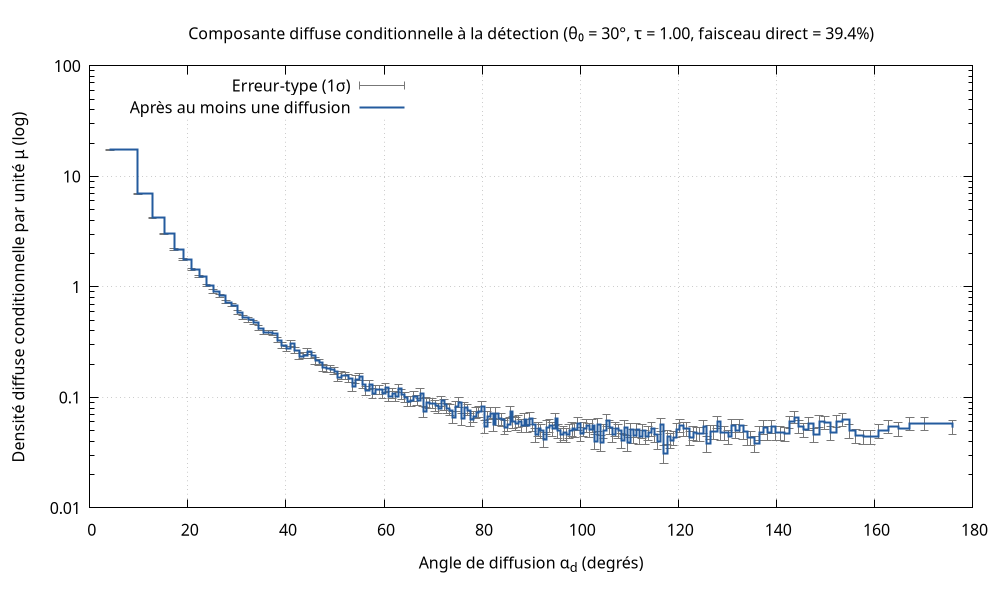
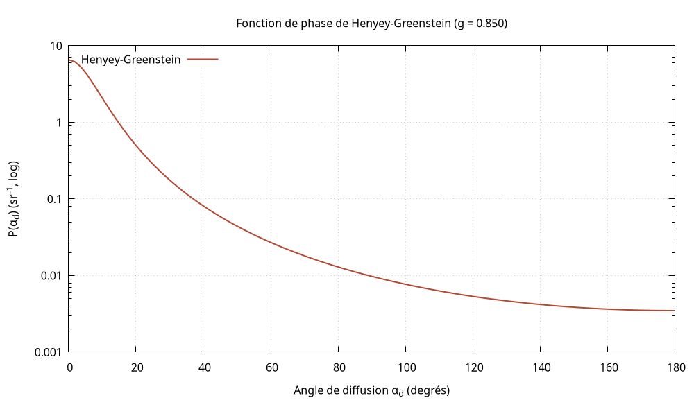
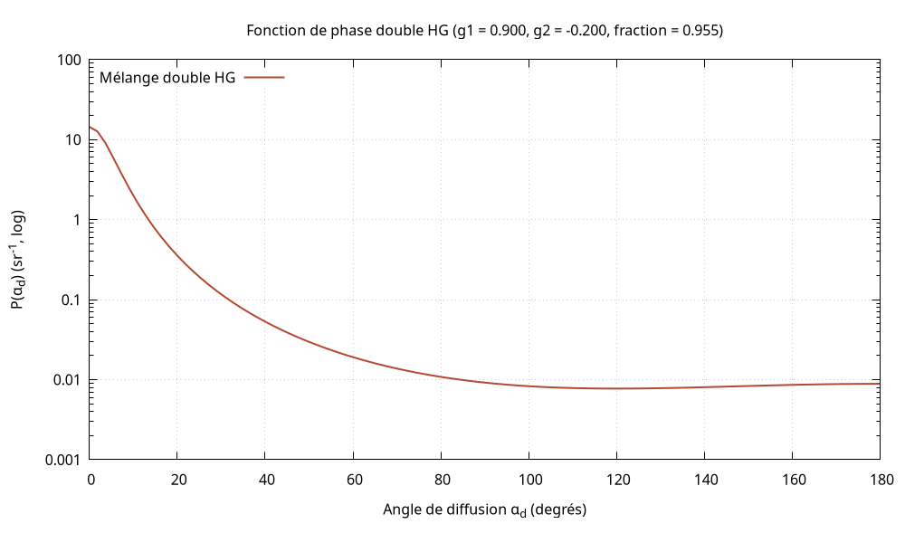
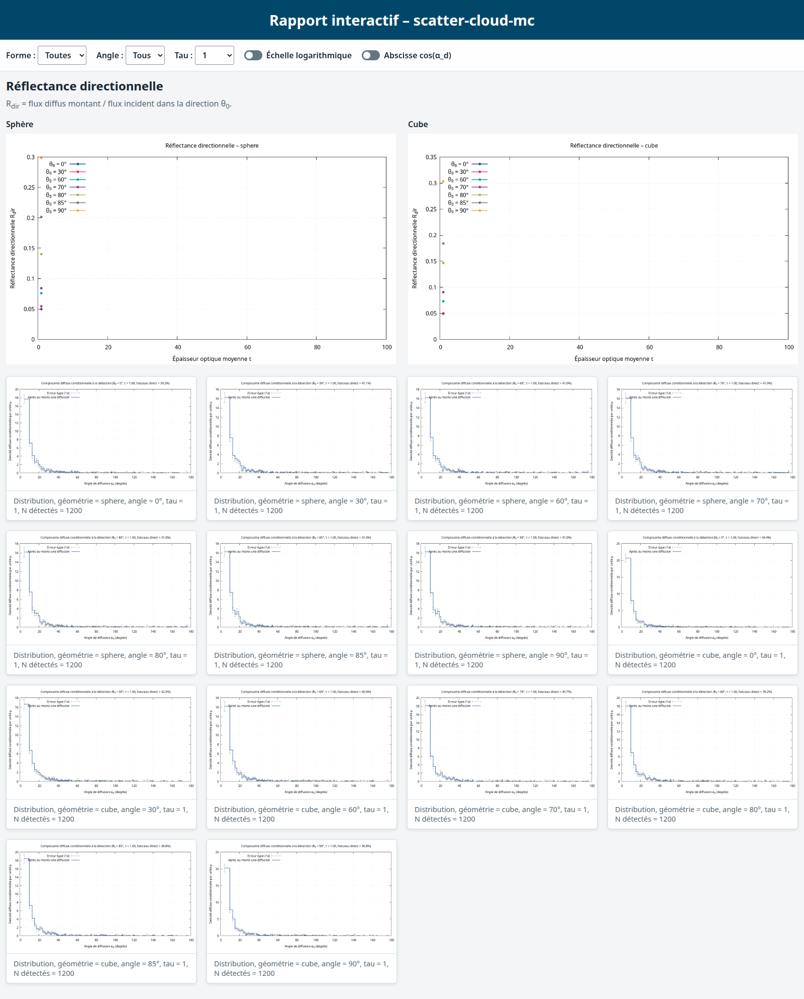

# Scatter Cloud MC

Simulateur Monte Carlo en C11 du transport de photons dans un nuage (sphère ou cube).
Modélise la diffusion Henyey–Greenstein, l'absorption pondérée et l'incidence oblique.
Exporte CSV, distributions angulaires et graphiques.


## Démarrage Rapide

**Prérequis** : GNU Make, GCC C11, Bash. Optionnel : Gnuplot (graphiques), Python 3.8+ (analyse), clang-format/cppcheck/clang-tidy (`make quality`).

```bash
make build    # compile
make test     # lance les tests (111 tests)
make run      # simulation avec config/config.dat → output/default/
```

## Structure du Projet

```text
src/ include/     # code C11 et headers
tests/            # tests unitaires
config/           # config.dat + template
examples/         # scripts d'usage courant
gnuplot/ web/     # templates graphiques + rapport HTML
build/ output/    # artefacts (git-ignored)
```

## Documentation Détaillée

### Utilisateurs
- [Configuration](docs/CONFIG.md) — clés, validation, géométries
- [Modèle Physique](docs/PHYSICS.md) — équations, conventions, phase functions
- [Précision Numérique](docs/NUMERICS.md) — RNG, Kahan, HG stable, erreur MC, roulette
- [Commandes Make](docs/COMMANDS.md) — build, test, run, sweep, plot, report, clean
- [Formats de Sortie](docs/OUTPUT.md) — CSV, distributions, bilan énergétique
- [Performance](docs/PERFORMANCE.md) — benchmarks, complexité, profiling, parallélisation

### Contributeurs
- [Architecture](docs/ARCHITECTURE.md) — diagramme Mermaid, modules, répertoires
- [Tests](docs/TESTING.md) — framework, structure AAA, suites, patterns
- [Git Workflow](docs/GIT_WORKFLOW.md) — commits, branches, PRs
- [CI/CD](docs/CI_CD.md) — GitHub Actions, jobs, matrice, extensions
- [Spécifications](PROJECT.md) — description, deps, structures, fonctionnalités

### Références
- [Bibliographie](docs/REFERENCES.md) — articles, standards, algorithmes

## Exemple Minimal

```bash
# Configuration par défaut (sphère, double HG, 10k photons)
make run

# Résultats dans output/default/ :
# - *.csv           : photons bruts
# - *.distribution.csv : distribution agrégée + erreurs
# - *.flux.csv      : bilan énergétique
# - *.png           : graphiques
# - stats.txt       : résumé
```

## Captures d'Écran

| Distribution angulaire | Fonction de phase HG |
|------------------------|----------------------|
|  |  |

| Fonction de phase Double HG | Rapport interactif |
|----------------------------|-------------------|
|  |  |


