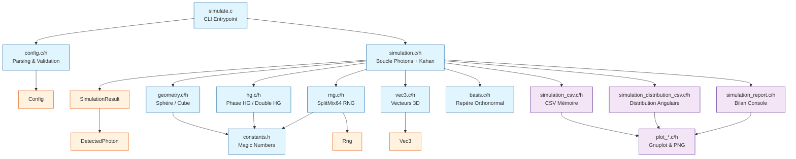

# Architecture - scatter-cloud-mc

## Diagramme Modules (Mermaid)

## Structure Répertoires

- **src/** : code source C11 (19 fichiers)
- **include/** : headers publics (16 fichiers)
- **tests/** : tests unitaires (15 suites, 108 tests, runner partagé)
- **output/** : fichiers générés (CSV, PNG, logs)
- **docs/** : documentation (11 fichiers) + screenshots/
- **examples/** : 10 scripts guidés (bash, python, gnuplot)

## Modules Principaux

| Fichier | Responsabilité |
| ------- | -------------- |
| `simulation.c/h` | boucle photons, transport, statistiques Kahan |
| `geometry.c/h` | distances, entrées, cordes (sphère/cube) |
| `hg.c/h` | échantillonnage HG / Double HG |
| `rng.c/h` | SplitMix64 |
| `vec3.c/h` | vecteurs 3D |
| `config.c/h` | parsing, validation config |
| `simulate.c` | entrypoint CLI |
| `simulation_csv.c/h` | export CSV (mémoire + streaming) |
| `simulation_distribution_csv.c/h` | distribution agrégée |
| `simulation_report.c/h` | bilan énergétique console |
| `plot_*.c/h` | génération graphiques Gnuplot |
| `file_path.c/h` | utilitaires chemins |
| `basis.c/h` | repère orthonormal local |

## Modules Utilitaires

### `file_path.c/h`
Utilitaires manipulation chemins fichiers :
- `replace_extension(const char *path, const char *new_ext, char *out, size_t cap)` : remplace extension, gère absence extension, buffer trop petit
- `ensure_dir(const char *path)` : crée répertoires parents récursivement

Tests : `test_file_path.c` (5 tests - extensions, buffers, edge cases)

### `basis.c/h`
Construction repère orthonormal local à partir d'un vecteur direction :
- `make_basis(const Vec3 *dir, Vec3 *u, Vec3 *v, Vec3 *w)` : base (u,v,w) avec w = dir normalisé
- `make_basis_from_z(Vec3 *u, Vec3 *v, Vec3 *w)` : cas spécial dir = +Z (évite singularité)

Tests : `test_basis.c` (2 tests - orthonormalité, cas Z)